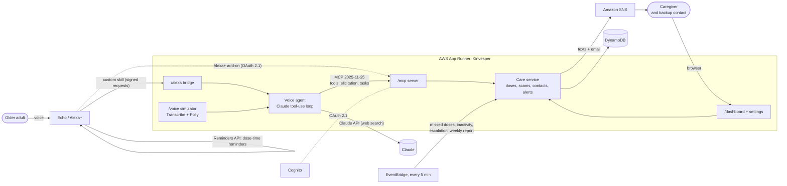

# Kinvesper

A voice-first eldercare companion for Alexa+, built as a self-hosted **MCP server (protocol 2025-11-25)**.
It helps an older adult who lives alone manage medications, avoid scams and stay connected to family,
and keeps the family caregiver informed.

- **On any Echo:** "Alexa, open kin vesper", then ask anything: "did I take my pills?", "someone
  says my grandson needs bail money", "tell Priya I'm fine", "what's the weather today?". In English
  or Hindi.
- **The Echo reminds them:** "set up my pill reminders" has Alexa itself announce every dose time;
  "remind me to call Priya at 5" sets a one-off reminder; "set an alarm for my doctor's appointment"
  sets an important alarm (a heads-up 30 minutes before, ringing until stopped, and the family told).
- **Scam shield:** red-flag checks plus the family's trusted numbers, to catch callers pretending to
  be the bank, the doctor or a grandchild.
- **Family in the loop:** alerts by text and email, a phone call for anything urgent, a backup contact
  when nobody answers, a daily "I'm okay" check-in, a weekly report, and messages typed in the
  dashboard that the Echo reads out.
- **Medicine safety:** "can I take ibuprofen?" is checked against their medicines in the FDA's drug
  labels; a photo of a prescription fills in the medicine list; asking about pills again and again
  is gently flagged to the family.
- **For the family and the doctor:** "Ask Kinvesper" answers questions about the week from the real
  data, and a printable doctor-visit summary has adherence, symptoms and questions to ask.
- **Company:** "let's chat" starts a conversation about their life; the memories they share are
  kept for the family.

## Architecture



| Layer | AWS service |
|---|---|
| Compute | App Runner (one container: MCP server, Alexa bridge, voice agent, dashboard) |
| Data | DynamoDB (one table), Secrets Manager (keys and tokens) |
| Identity | Cognito (OAuth 2.1 for `/mcp` and Alexa+ account linking) |
| Alerts | SNS (SMS to the phone, email to the caregiver and the backup contact), Twilio or End User Messaging (spoken phone calls for urgent alerts) |
| Schedules | EventBridge (proactive checks every 5 minutes) |
| Speech (simulator) | Transcribe (speech to text), Polly (text to speech) |
| Ops | CloudWatch (logs, a 5xx alarm), ECR (the image) |

## Quick start

```bash
make dev                                  # installs dependencies and starts everything on :8000
```

It uses Claude when `ANTHROPIC_API_KEY` is in `.env` (see `.env.example`), else a local
[Ollama](https://ollama.com) model when one is running (`ollama pull llama3.1`), else the offline
keyword router, so it needs no accounts or keys. `make help` lists the other
commands (`make test`, `make seed`, `make dev-aws`). Step by step instead:

```bash
uv sync
uv run kinvesper                          # MCP endpoint at http://127.0.0.1:8000/mcp
                                          # voice simulator at http://127.0.0.1:8000/voice
                                          # caregiver dashboard at http://127.0.0.1:8000/dashboard
uv run python scripts/demo_client.py      # in another terminal: walk through demo scenarios
uv run pytest                             # unit + end-to-end MCP tests
```

The first run seeds a demo household (Margaret, 78, and her daughter Priya) with a week of dose
history. Reset it any time with `uv run kinvesper --seed`.

Inspect it interactively with the MCP Inspector:

```bash
npx @modelcontextprotocol/inspector      # transport: Streamable HTTP, URL: http://127.0.0.1:8000/mcp
```

## MCP surface

| Tools | What it does |
|---|---|
| `get_medication_schedule` | Today's doses with status (taken / due / missed / upcoming); ask about one med by name or purpose |
| `log_medication_dose` | Logs a dose, with a **double-dose guard** |
| `add_medication` | Adds a prescription |
| `check_for_scam` | Elder-fraud red-flag check plus the caller's number against the trusted contacts; alerts family on anything suspicious |
| `find_trusted_contact` | The bank's, doctor's or a relative's real number, as the family saved it |
| `set_reminder` | A one-off reminder at a time; `important` makes it an alarm (heads-up, ringing timer, caregiver told) |
| `list_reminders`, `cancel_reminder` | Upcoming reminders and alarms; cancel one by what it's about |
| `daily_check_in` | Mood and symptoms; escalates falls, dizziness and chest pain |
| `notify_caregiver` | Sends a message to the caregiver |
| `emergency_help` | Sends an urgent alert immediately |
| `get_care_summary` | Adherence stats plus a written weekly summary |
| `request_pharmacy_refill` | Orders a refill; runs as an async **task** with progress updates |
| `check_medicine_interactions` | "Can I take ibuprofen?": the FDA drug labels (openFDA) read by Claude, against their medicines |
| `get_family_messages` | Messages the family typed in the dashboard, read out once |
| `start_conversation`, `save_memory` | Companionship: a gentle question about their life; memories they share, kept for the family |

**Resources:** `care://profile`, `care://medications`, `care://today`, `care://alerts`, `care://refills`.
**Prompts:** `morning_check_in`, `weekly_caregiver_report`.
Every tool has annotations, a title, an icon and an `outputSchema`, and returns `structuredContent`.

**2025-11-25 spec features:**

- **Tasks:** `request_pharmacy_refill` declares `execution.taskSupport: "optional"`. Call it with a
  `task` field and poll `tasks/get` to watch it move from requested to ready. A plain call finishes at once.
- **Elicitation:** `notify_caregiver` asks the person to confirm before it messages family. Clients
  without elicitation send as asked. Scam and emergency alerts never ask, because scammers push secrecy.
- **Icons:** on the server, every tool, every resource and every prompt.
- **OAuth 2.1:** set `OAUTH_ISSUER` (Amazon Cognito) and `/mcp` requires a bearer JWT. The server
  publishes `/.well-known/oauth-protected-resource/mcp` and answers 401 with a `WWW-Authenticate`
  challenge. It checks signature, expiry, issuer, audience and scopes.

## Voice simulator

Open `/voice` in any modern browser to talk to Kinvesper the way you would to Alexa+: tap the mic
and speak (it stops by itself when you pause), or type. Each reply shows the MCP tool calls behind
it. Scenario buttons cover the demo flows.

- **Speech runs on the server,** because browsers' built-in speech support varies too much (Brave and
  Firefox can't recognise speech; Linux browsers often have no voices). The page records audio and
  the server turns it into text (`STT_PROVIDER`): locally with
  [Whisper](https://github.com/SYSTRAN/faster-whisper) (`STT_MODEL`, default `small.en`, on the CPU,
  no account needed, about a second), and in the cloud with **Amazon Transcribe** (about a second;
  Whisper takes ~8 s on App Runner's CPU). Whisper is primed with the person's, caregiver's and
  medicines' names, and both correct near-misses of them ("Tell Pri" becomes "Tell Priya").
  Replies are spoken with **Amazon Polly** (`TTS_VOICE`, default Joanna); without AWS credentials
  the page falls back to the browser's own voice. The first local run downloads the Whisper model
  (~250 MB).

- **Brain:** with `LLM_PROVIDER=bedrock` or `anthropic`, Claude runs a tool-use loop over the tools
  it discovers from `/mcp`. With `LLM_PROVIDER=none`, a keyword router picks one tool per utterance,
  so the demo works offline.
- **Real MCP client:** every conversation opens its own Streamable HTTP session to `/mcp`, using
  `SERVICE_TOKEN` when OAuth is on.
- **Elicitation by voice:** "Tell Priya…" makes the server ask "Send this to Priya?". The question is
  spoken, and your next answer ("yes" / "no") goes back as the elicitation response.
- **Tasks by voice:** a refill runs as an MCP task. The page announces the result when it finishes,
  and Claude hears about it on the next turn.
- **Access:** open when OAuth is off. With OAuth on it needs `SERVICE_TOKEN` and `SIMULATOR_KEY`
  (`/voice?key=...`), otherwise it is switched off.

### Connecting to Alexa+

See [alexa/README.md](alexa/README.md): the add-on manifest, account linking and the steps to deploy it.

### Testing with an external Alexa+ simulator

Community simulators such as [mcp-voice-simulator](https://github.com/AlSayedGamal/alexa-ai-web-simulator)
act as Alexa+'s MCP client. To reach Kinvesper from another machine or a hosted tool, open a tunnel
and set `PUBLIC_URL` to it. Hosts not in `PUBLIC_URL` are refused (421) by DNS-rebinding protection.

```bash
cloudflared tunnel --url http://127.0.0.1:8000        # or: ngrok http 8000
PUBLIC_URL=https://<tunnel-host> uv run kinvesper    # MCP URL: https://<tunnel-host>/mcp
```

To skip account linking while OAuth is on, give the simulator `SERVICE_TOKEN` as its bearer token
(`MCP_BEARER_TOKEN` in mcp-voice-simulator).

## Caregiver dashboard and proactive checks

`/dashboard` is the family caregiver's view: 7-day adherence, today's doses, alerts (with
acknowledge), mood at check-in, medications with low-stock warnings and pharmacy refills. It
refreshes every 15 seconds, so doses logged by voice show up on their own.

`/dashboard/settings` is where the household is set up, nothing is hard-coded: the person, the
caregiver's name, phone and email, and each medicine (dose, times, instructions, pills left). Voice,
Alexa and alerts all read it from the store; the demo household is only first-run sample data.
Alerts reach the caregiver through Amazon SNS: texts straight to the phone, and email through the
alerts topic (saving an email subscribes it; Amazon sends a confirmation link). "Send test alert"
checks both. Anything suspicious alerts: medium-risk scam checks as a warning, high-risk as urgent,
as well as emergencies, worrying check-ins and messages.

Settings also holds:

- **A backup contact.** An urgent alert (a fall, chest pain, a likely scam) that nobody acknowledges
  within `ESCALATE_AFTER_MIN` minutes (10) goes to them too, once.
- **Trusted contacts:** the real numbers of the bank, the doctor and family. "Someone from my bank
  called from 98 4123 9999" is checked against the bank's saved number; a different number is an
  impersonation (high risk, the caregiver is alerted, and Kinvesper reads out the real number to
  call back on). A matching number never lowers the risk: caller ID can be faked.
- **Send weekly report now,** besides the automatic one.
- **Scan a prescription:** a photo of a prescription or pill box; Claude reads the medicines, doses
  and times ("BD" becomes 8 AM and 8 PM, "as needed" medicines are set aside) for the caregiver to
  check before saving. New medicines are checked for interactions with the rest.
- **A daily "I'm okay" check-in** time: the Echo asks, and silence tells the family.

**Phone calls for urgent alerts** go through Twilio (a free trial is enough: it calls the numbers
verified in the Twilio console). Put `TWILIO_ACCOUNT_SID`, `TWILIO_AUTH_TOKEN` and `TWILIO_FROM` in
`.env` and run `make twilio`, which stores them in Secrets Manager and restarts the service. The call
reads the alert out and asks the caregiver to press 1, which acknowledges it on the dashboard
(Twilio signs that request, and the server checks the signature). `VOICE_CALL_FROM` uses AWS End
User Messaging instead, once the account's voice spending limit is raised.

**WhatsApp alerts** go through Twilio too: add `TWILIO_WHATSAPP_FROM` (the sandbox number
`+14155238886`, or your own WhatsApp sender) and run `make twilio` again. Every alert texted to the
caregiver (and escalations to the backup contact) also arrives on WhatsApp. This needs an upgraded
Twilio account: a free trial's "Try out WhatsApp" sender only sends Twilio's sample templates, not
your own text. On the sandbox, each phone first sends the sandbox's `join <code>` message. WhatsApp
allows free text only within 24 hours of that phone's last message; after that, Kinvesper sends the
approved template in `TWILIO_WHATSAPP_TEMPLATE` (body like `Kinvesper alert: {{1}}. {{2}}`) when
one is set, so reply to it (or rejoin) before a demo. With the sandbox's "When a message comes in" webhook set to `<ServiceUrl>/api/whatsapp/incoming`
the caregiver can reply:

| Reply | What happens |
|---|---|
| `OK` (or "on it", "done", 👍) | The newest open alert is marked handled on the dashboard |
| `STATUS` | Today's doses taken and missed, the last check-in mood and open alerts |
| anything else | Saved as a family message and read out on the Echo next time |

Replies are Twilio-signed (checked like the call's "press 1") and only count from the caregiver's
and backup contact's saved numbers. In production the sender is your own WhatsApp Business number
instead of the shared sandbox one.

The dashboard also has **Ask Kinvesper** (Claude answers questions about the last two weeks from the
care data, and says so when it doesn't track something), **Send a message** (read out on the Echo
next time, with "heard" shown), **Memories** from companionship chats, and a printable **Doctor
visit** summary (`/dashboard/doctor`): adherence per medicine and by time of day, mood, symptoms,
events and questions to ask, counted only from the day Kinvesper started being used.

A scheduler inside the server runs every `SCHEDULER_INTERVAL_S` seconds (in the cloud, EventBridge
calls it every 5 minutes):

| Check | Alert | Sent to the caregiver |
|---|---|---|
| Dose not logged `MISSED_DOSE_GRACE_MIN` after its time | warning | yes |
| No interaction for `INACTIVITY_HOURS` (08:00-21:00 only) | warning | yes |
| `LOW_STOCK_THRESHOLD` pills or fewer, no refill underway | info | no |
| Urgent alert unacknowledged for `ESCALATE_AFTER_MIN` | to the backup contact | backup |
| `REPORT_DAY` after `REPORT_TIME` (Sunday 18:00): the weekly report, written by Claude | info | email |
| An important alarm comes due | warning | yes |
| Nothing heard `CHECKIN_GRACE_MIN` after the daily check-in time | warning | yes |
| Urgent alert unacknowledged for `CALL_AFTER_MIN` (an emergency: at once) | phone call; pressing 1 acknowledges it | yes, once Twilio is set up |
| The same question `REPEAT_THRESHOLD` times in a day (a double dose attempt: twice) | info (warning) | no (yes) |
| A possible medicine interaction | info, warning if serious | dashboard |

Every alert carries a de-duplication key, so a missed dose texts the caregiver once, however
often the checks run. `uv run kinvesper --check` runs them once, for cron or EventBridge.
With OAuth on, the dashboard needs `DASHBOARD_KEY` (`/dashboard?key=...`).

## On Alexa

The classic skill in `alexa/skill` reaches Kinvesper from any Echo today (the Alexa+ add-on in
`alexa/addon-package` waits on Amazon's allowlist). See [alexa/README.md](alexa/README.md).

- **Echo reminders:** "set up my pill reminders" asks for the reminders permission by voice, then
  creates one daily reminder per dose time with the Alexa Reminders API ("Margaret, it's time for
  your Metformin, 500 mg, and Lisinopril... take with food"). When the medicines change in Settings,
  the reminders are rebuilt the next time the skill opens. "Turn off my reminders" removes them.
- **One-off reminders and alarms:** Claude saves them with `set_reminder` (it knows the local time:
  every turn carries a `[Now]` line), and the bridge puts them on the Echo with the same permission.
  An important alarm adds a heads-up 30 minutes before, a timer that rings until "Alexa, stop" when
  it's due within 2 hours (the Timers API's limit), and an alert to the caregiver at the time. The
  dashboard lists them, with Cancel.
- **Echo Show:** every reply also shows today's medicines in large print, with a "Taken" button for
  each dose that's due.
- **Family messages** typed in the dashboard are read out when the skill opens.
- **Daily check-in:** the Echo asks at the time set in Settings ("please let me know you're okay").
- **Hindi:** the skill has a hi-IN model. The fixed phrases are translated, times are spoken the
  Hindi way ("रात 8 बजे"), and Claude answers in Hindi.
- **Anything else:** questions outside care (facts, recipes, maths, the weather, the news) are
  answered by Claude, with web search for today's information.

## Responsible AI

- **Not a doctor.** Kinvesper never diagnoses or changes doses. Medication facts come only from the
  schedule the family saved, through the tools; Claude doesn't guess them. Care questions are
  answered with the tool's own spoken reply, built from the real data, so doses can't be misstated.
- **Double-dose guard.** Logging a dose that's already taken says clearly: don't take another.
- **Interaction checks cite the FDA labels** and never call a combination safe: "no problem found in
  the labels, still check with your pharmacist". A scanned prescription is never saved until a person
  has checked it.
- **Repeated questions are an observation, not a diagnosis:** the family note says it can be habit
  or worry, and to mention it to the doctor if it keeps happening.
- **Emergencies:** "I fell" or "chest pain" alerts the family at once and tells the person to call
  the local emergency number (set in Settings: 112, 911, 999...). Kinvesper doesn't contact
  emergency services itself, and never claims help is on the way.
- **Asks before acting for the person.** Messages to family need a spoken yes (MCP elicitation).
  Scam and emergency alerts never ask, because scammers push secrecy.
- **Caller ID can be faked,** so a known number never makes a call "safe": Kinvesper says to call
  back on the saved number before doing anything.
- **Privacy:** health data stays in the family's own AWS account (DynamoDB, encrypted at rest). The
  dashboard needs a key; `/mcp` needs OAuth. Alexa sends text, never audio. Keys live in Secrets
  Manager, never in the code or the image. The privacy policy is at `/privacy`.
- **Honest failure:** if Claude is unreachable, the keyword router still handles the core care
  actions; a failed text never stops the email; nothing pretends a message was sent when it wasn't.

## Deploying to AWS

`infra/` holds a CDK stack that deploys Kinvesper on App Runner with DynamoDB, Cognito (OAuth 2.1),
SNS, Secrets Manager, EventBridge and CloudWatch, with Claude through the Claude API (or Bedrock). Steps: [infra/README.md](infra/README.md).

To run on your own machine against the deployed stack (same DynamoDB table and SNS topic as the
cloud app) with a local Ollama model, after `aws configure`:

```bash
./scripts/run_local_aws.sh             # looks up the stack outputs, then starts the app on :8000
```

```bash
docker build -t kinvesper .            # the same image App Runner runs
docker run -p 8080:8080 kinvesper      # http://127.0.0.1:8080/voice
```

## Configuration

See `.env.example`. Everything runs offline with `LLM_PROVIDER=none` (rule-based scam detection
and template summaries). Set `LLM_PROVIDER=bedrock` to use Claude on Amazon Bedrock, or
`LLM_PROVIDER=anthropic` for the Claude API.

To use a free local model instead, run [Ollama](https://ollama.com) (it speaks the same Messages API):

```bash
ollama pull llama3.1
LLM_PROVIDER=ollama uv run kinvesper     # LLM_MODEL=<any tool-capable model>, OLLAMA_URL=... to change
```

## Layout

```
src/kinvesper/
  app.py          HTTP entry point (Starlette + uvicorn), /mcp and /health
  mcp_server.py   MCP tools, resources, prompts, task-augmented tool calls
  auth.py         OAuth 2.1 resource server: JWT verification against Cognito
  icons.py        SVG icons for tools, resources and prompts
  voice.py        voice agent: Claude tool-use loop over MCP, offline router, spoken elicitation
  alexa.py        Alexa skill bridge (/alexa): Amazon's request checks, sessions, reminders
  reminders.py    Echo reminders: pills, one-offs and alarms (Alexa Reminders and Timers APIs)
  when.py         reading and saying reminder times ("in 2 hours", "at 5 PM tomorrow")
  i18n.py         the skill's fixed phrases in English and Hindi
  contacts.py     trusted contacts: phone number matching and impersonation checks
  listing.py      privacy and terms pages, store icons
  web.py          voice simulator routes (/voice, /api/voice/...)
  dashboard.py    caregiver dashboard routes (/dashboard, /api/dashboard, ...)
  interactions.py medicine interaction checks: openFDA drug labels read by Claude
  apl.py          the Echo Show screen (Alexa Presentation Language)
  scheduler.py    proactive checks on a timer (missed doses, inactivity, low stock)
  static/         simulator and dashboard pages
  service.py      care logic (schedule, dose guard, alerts, check-ins, summaries)
  scam.py         fraud red-flag rules + optional Claude refinement
  store.py        JSON-file or DynamoDB document store
  llm.py          Claude via Bedrock (Mantle) or the Claude API
  notify.py       caregiver alerts via Amazon SNS (text to the phone, email through the topic)
  seed.py         demo household
```

## Roadmap

Details and the AWS services per phase are in [PHASES.md](PHASES.md).

- [x] **Phase 1:** core MCP server, tools, resources and prompts, tests
- [x] **Phase 2:** Tasks (async pharmacy refill), elicitation (confirm before messaging family), icons, OAuth 2.1
- [x] **Phase 3:** Alexa+-style voice simulator web app with a Claude agent
- [x] **Phase 4:** caregiver dashboard, missed-dose and inactivity scheduler, SNS SMS
- [x] **Phase 5:** AWS deployment (App Runner, DynamoDB, Cognito, SNS, EventBridge, CDK)
- [x] **Phase 6:** Alexa skill bridge, Claude API brain with web search, household settings,
  trusted contacts, escalation to a backup contact, weekly report, Echo reminders, Hindi
- [x] **Phase 7:** medicine interaction checks (FDA labels), prescription photos, Ask Kinvesper,
  daily check-in, phone calls for urgent alerts, repeated-question notes, doctor visit summary,
  family messages, companionship and memories, Echo Show screen, WhatsApp alerts with replies (Twilio)
- [ ] **Next:** multi-family accounts, Alexa+ add-on (waiting on the allowlist)

## License

[MIT](LICENSE)
